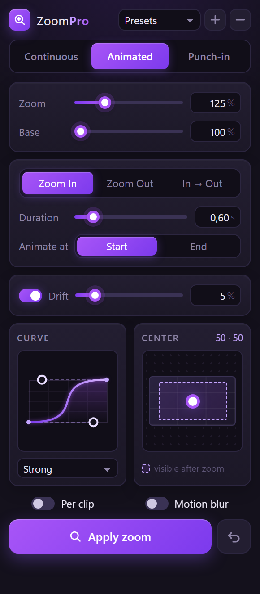

# ZoomPro for Premiere Pro

Select clips, click **Apply zoom**, and ZoomPro drops an **adjustment layer** above them, trimmed to the exact length of your selection, with the zoom already keyframed. No more placing keyframes by hand.

<p align="center"></p>

## Features

- **Three zoom modes**
  - **Continuous**: a slow push from the first frame to the last frame of the selection.
  - **Animated**: zoom in, zoom out, or in → out, with a duration you choose, at the start or at the end of the selection.
  - **Punch-in**: an instant zoom with no animation.
- **Real easing curves**: 12 presets (Smooth, Ease In-Out, Strong, Expo, Back…) plus a custom bezier you edit by dragging the handles. Premiere has no curve editor of its own, so ZoomPro bakes the curve into keyframes and removes the redundant ones.
- **Drift**: after an animated zoom or a punch-in, the zoom keeps moving slowly until the end of the layer.
- **Zoom center**: click or drag inside the frame to pick the point you zoom into. The dashed box shows what stays visible at the final zoom.
- **Per clip**: one adjustment layer per selected clip instead of one for the whole selection.
- **Update in place**: select an existing ZoomPro layer, change the settings and click Apply. That layer is updated instead of a new one being created.
- **Motion blur**, **presets**, and **undo last zoom**.

Everything goes on an adjustment layer (with the **Transform** effect), so your clips are never touched.

## Requirements

- Adobe Premiere Pro **2022 (v22) or newer**, on Windows or macOS.
- Any UI language. The Transform effect is found by its internal name.

## Install

1. Download the latest **ZoomPro-vX.Y.Z.zip** from the [Releases](../../releases) page. You can also use **Code › Download ZIP** on this page.
2. Unzip it.
3. Run the installer for your system:
   - **Windows**: double-click `Install-Windows.bat`.
   - **macOS**: right-click `Install-Mac.command` and choose **Open**, then **Open** again. macOS asks this for scripts downloaded from the internet. If double-clicking is blocked, open Terminal and run:
     ```bash
     bash ~/Downloads/ZoomPro/Install-Mac.command
     ```
     Change the path if you unzipped it somewhere else.
4. Restart Premiere Pro and open **Window › Extensions › ZoomPro**.

The installer copies the panel to Adobe's extensions folder. It also turns on `PlayerDebugMode`, a standard setting that lets Premiere load panels that don't come from Adobe Exchange.

To remove the panel, run `Uninstall-Windows.bat` or `Uninstall-Mac.command`.

## How to use

1. Select the clips in the timeline. Video, audio, or both: ZoomPro uses the full span of the selection.
2. Pick a mode, the zoom %, the curve and the center.
3. Click **Apply zoom**.

The new layer lands on the first free video track above your clips. If no track is free, ZoomPro adds one. The layer is named like `ZOOM · 120% In 0.6s +5`, so you can tell zooms apart on the timeline.

**The first time in a project**, ZoomPro needs an adjustment layer in the Project panel. It imports one by itself from the plugin. If that ever fails, it shows how to create one: **File › New › Adjustment Layer**.

## Tips

- **Base** is the scale the zoom starts from (or returns to). Leave it at 100%.
- A center near an edge keeps that edge in place. Click the middle of the frame to zoom straight in.
- Each Apply creates several steps in Premiere's undo history. To remove a whole zoom in one click, use the **↶** button.

## How it works

ZoomPro is a CEP panel: HTML/JS in `extension/client`, ExtendScript in `extension/host`. The panel builds the keyframes, and the ExtendScript side inserts the adjustment layer, adds Transform through Premiere's QE API, and writes the keyframes. Anchor point and position are set to the chosen center, so that point stays fixed while the image scales around it.

## License

[MIT](LICENSE)
